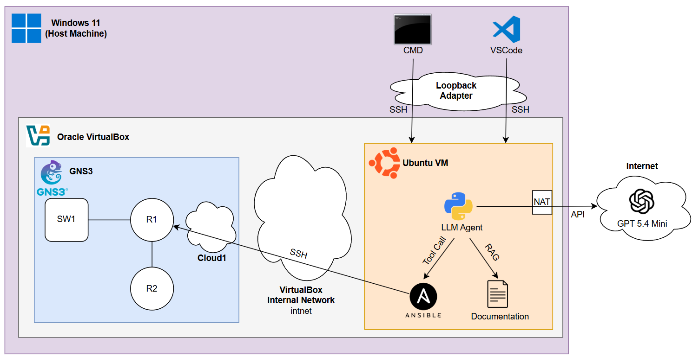
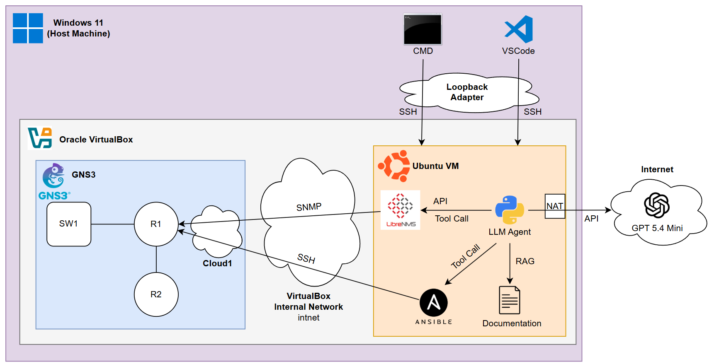
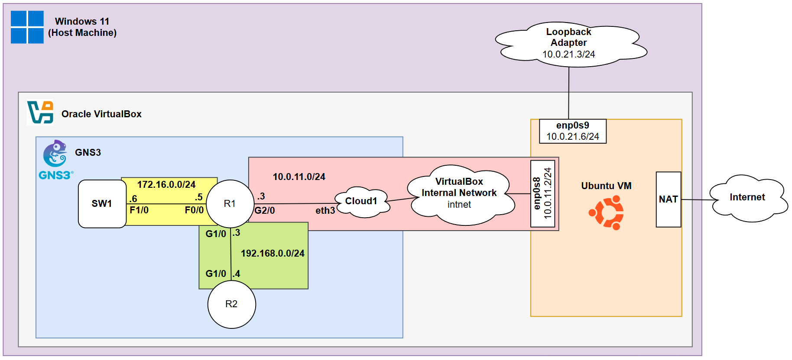
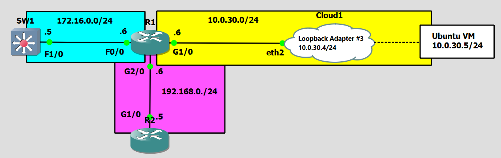

# AI Agent Network Automation

An AI agent that monitors a simulated Cisco network and makes configuration changes from plain-English instructions. Instead of writing Ansible playbooks by hand, you tell the agent what you want and it does the work. The agent can look at the network freely, but it changes device configurations only after you explicitly approve.

The network is simulated in **GNS3**. The agent runs on an **Ubuntu VM** in **Oracle VirtualBox**. Both connect to a **Microsoft KM-TEST Loopback Adapter** on the Windows 11 host, which lets the VM, the GNS3 devices and the host reach each other.

The agent is built with **LangGraph** and **LangChain** and uses OpenAI's **GPT-5.4 Mini** model.

**Demo videos:**
<br>[https://www.youtube.com/watch?v=SQOBbE-cZoo](https://www.youtube.com/watch?v=SQOBbE-cZoo)
<br>[https://www.youtube.com/watch?v=ls9ItnTJ2VA](https://www.youtube.com/watch?v=ls9ItnTJ2VA)

**Setup guides:**
1. [Setup_1_GNS3_Ansible.md](Setup_1_GNS3_Ansible.md): GNS3, VirtualBox, Ubuntu VM, Ansible, packet capture and the basic AI agent
2. [Setup_2_LibreNMS.md](Setup_2_LibreNMS.md): LibreNMS monitoring, the LibreNMS API and the full AI agent

<br>

## What the Agent Does

The agent has two main jobs:
- **Monitor** the network and answer questions about its current state.
- **Make configuration changes** when you ask for them.

### Safe by design

The agent can plan and run commands that only **view** the network (`show` commands, pings, packet captures and LibreNMS queries) on its own.

Any command that **changes** a device's configuration needs your explicit confirmation:
1. The agent writes an Ansible playbook for the change and checks that its YAML is valid.
2. It shows you the playbook.
3. It does a dry run (`ansible-playbook --check --diff`) and shows you exactly what would change on each device.
4. You review the changes, and the playbook is applied only after you approve it at the prompt.

This keeps a person in control of every change, so the network changes only in the ways you have approved.

### Tools

The agent has four groups of tools:

#### 1. Read documentation
The agent reads [documentation.txt](documentation.txt), a short description of the network, so it understands the topology before it acts.

#### 2. Run Ansible commands
Using Ansible over SSH, the agent can:
- run `show` commands (for example `show ip int br` or `show run`) and explain the output
- run pings from a device
- back up running configurations to the `configs/` folder
- write, validate and run playbooks for configuration changes, after you approve them (saved in `playbooks/`)

#### 3. Run packet capture commands
The agent captures traffic on the Ubuntu VM's network interfaces with `tcpdump` and saves it as a `.pcap` file in `packet_captures/`. It then reads the capture and explains the traffic in plain language.

#### 4. Run LibreNMS tools (advanced setup)
LibreNMS runs on the Ubuntu VM and polls the GNS3 devices over SNMP. Through the LibreNMS API, the agent can:
- list the monitored devices
- check device health, interfaces and availability
- look up outages and active alerts

<br>

## Architecture

### Tech stack

The **basic** setup is what you get by following [Setup_1_GNS3_Ansible.md](Setup_1_GNS3_Ansible.md) only. The **advanced** setup is what you get by continuing with [Setup_2_LibreNMS.md](Setup_2_LibreNMS.md).

<b>Basic</b>



<b>Advanced</b>



| Component | Role |
|---|---|
| **Windows 11 host** | Runs VirtualBox, VSCode (Remote - SSH into the VM) and a browser for the LibreNMS web UI |
| **Microsoft KM-TEST Loopback Adapter** | Host network adapter that connects the host, the Ubuntu VM and GNS3 (`10.0.30.0/24`) |
| **Oracle VirtualBox** | Hosts the Ubuntu VM and the GNS3 VM |
| **GNS3** | Simulates the network: Cisco C7200 routers (R1, R2) and a C3725 EtherSwitch router (SW1) |
| **Ubuntu VM** | Runs the AI agent, Ansible, `tcpdump` and LibreNMS |
| **LLM agent** (Python, LangGraph) | Decides which tools to call based on your request |
| **OpenAI API** (GPT-5.4 Mini) | The language model behind the agent, reached over the VM's NAT adapter |
| **Ansible** (`cisco.ios`) | Runs commands and pushes configuration to the devices over SSH |
| **Ansible Vault** | Stores the device login details in encrypted files |
| **LibreNMS** | Monitors the devices over SNMP v2c and exposes the data through its API (advanced setup) |

### Network





### IP addressing

| Device | Interface | IP Address |
|---|---|---|
| Windows host | Microsoft KM-TEST Loopback Adapter | `10.0.30.4/24` |
| Ubuntu VM | `enp0s8` (bridged to the Loopback Adapter) | `10.0.30.5/24` |
| Ubuntu VM | `enp0s3` (NAT, Internet access) | DHCP |
| R1 | `g1/0` (to Cloud1 / Loopback Adapter) | `10.0.30.6/24` |
| R1 | `g2/0` | `192.168.0.6/24` |
| R1 | `f0/0` | `172.16.0.6/24` |
| R2 | `g1/0` | `192.168.0.5/24` |
| SW1 | `vlan 1` (port `f1/0`) | `172.16.0.5/24` |

R2 and SW1 use R1 as their default gateway. The Ubuntu VM reaches them through static routes via R1. The LibreNMS web UI is at `http://10.0.30.5` from the host.

<br>

## Project Structure

```
AI_Agent_Network_Automation
├── ai_agent_6_segmented.py       # Basic AI agent (Ansible + packet capture tools)
├── system_prompt_1.py            # System prompt for the basic agent
├── ai_agent_7_librenms.py        # Full AI agent (Ansible + packet capture + LibreNMS tools)
├── system_prompt_2.py            # System prompt for the full agent
├── documentation.txt             # Network description the agent reads
├── tools/
│   ├── ansible_tools.py          # Run commands, ping, back up configs, write/validate/run playbooks
│   ├── packet_capture_tools.py   # List interfaces, capture and read .pcap files
│   ├── librenms_tools.py         # LibreNMS API: devices, health, interfaces, availability, outages, alerts
│   └── test_librenms_tools.py    # Checks that every LibreNMS tool works
├── test_api_key.py               # Checks that the OpenAI API key works
├── test_librenms.py              # Checks that the LibreNMS API key works
├── hosts.ini                     # Ansible inventory (R1, R2, SW1)
├── host_vars/                    # Encrypted device logins (Ansible Vault)
│   ├── R1/vault.yaml
│   ├── R2/vault.yaml
│   └── SW1/vault.yaml
├── configs/                      # Device config backups (created by the agent)
├── playbooks/                    # Ansible playbooks written by the agent
├── packet_captures/              # .pcap files captured by the agent
├── .env                          # API keys (not committed)
├── .ansible_vault_password       # Vault password file (not committed)
├── requirements.txt              # Python dependencies
├── Setup_1_GNS3_Ansible.md       # Setup guide part 1
├── Setup_2_LibreNMS.md           # Setup guide part 2
├── Architecture/                 # draw.io source files for the diagrams
└── images/                       # Diagrams and screenshots used in the guides
```

<br>

## Prerequisites

1. GNS3 with Cisco images that support SSH (IOU images do not support SSH). Setup guide: [GNS3-Setup-with-Cisco-Images](https://github.com/faris1702/GNS3-Setup-with-Cisco-Images)
2. Oracle VirtualBox with an Ubuntu VM
3. VSCode with the Remote - SSH extension (recommended)
4. An OpenAI API key

<br>

## Quick Start

The full steps are in the two setup guides. In short:

**Part 1: [Setup_1_GNS3_Ansible.md](Setup_1_GNS3_Ansible.md)**

1. Add a Microsoft KM-TEST Loopback Adapter on Windows with IP `10.0.30.4/24` and allow ICMP through Windows Firewall.
2. In VirtualBox, bridge an adapter on both the Ubuntu VM and the GNS3 VM to the Loopback Adapter.
3. Build the GNS3 topology, set up IP addressing and default routes, and enable SSH on all devices.
4. On the Ubuntu VM, set `enp0s8` to `10.0.30.5/24`, install SSH, `tcpdump`, Python and Ansible, and allow `tcpdump` to run with `sudo` without a password.
5. Create a Python virtual environment and install the dependencies:
    ```
    python3 -m venv venv
    source venv/bin/activate
    pip install -r requirements.txt
    ```
6. Set up the Ansible inventory (`hosts.ini`), the Vault files in `host_vars/`, and `.ansible_vault_password`.
7. Add routes to the networks behind R1. This must be repeated every time the VM starts:
    ```
    sudo ip route add 192.168.0.0/24 via 10.0.30.6 dev enp0s8
    sudo ip route add 172.16.0.0/24 via 10.0.30.6 dev enp0s8
    ```
8. Add your OpenAI key to `.env` (`OPENAI_API_KEY="<LLM_API_KEY>"`), then run the basic agent:
    ```
    python3 test_api_key.py
    python3 ai_agent_6_segmented.py
    ```

**Part 2: [Setup_2_LibreNMS.md](Setup_2_LibreNMS.md)**

9. Install LibreNMS on the Ubuntu VM (nginx, PHP-FPM, MariaDB, snmpd) and finish the web install at `http://10.0.30.5`.
10. Enable SNMP on each device (`snmp-server community public RO`) and add R1, R2 and SW1 to LibreNMS.
11. Enable the LibreNMS API and create an API token.
12. Add the LibreNMS keys to `.env`:
    ```
    OPENAI_API_KEY="<LLM_API_KEY>"
    LIBRENMS_API_KEY="<LIBRENMS_API_KEY>"
    LIBRENMS_URL="http://127.0.0.1"
    ```
13. Test the setup and run the full agent:
    ```
    python3 test_librenms.py
    python3 tools/test_librenms_tools.py
    python3 ai_agent_7_librenms.py
    ```

<br>

## Example Prompts

- *"Show me the interface status of R1."*
- *"What is the IP address configured on SW1's VLAN 1?"*
- *"Back up the running config of R2."*
- *"Configure a loopback interface on R2 with IP 2.2.2.2/32."* → the agent writes a playbook and waits for your approval
- *"Capture 20 packets on enp0s8 and explain what you see."*
- *"Are there any active alerts on the network?"*
- *"How healthy is SW1, and has it had any outages?"*
