This is a continuation from the first setup. 
<br>

<h3>Objectives of the setup:</h3>

1. To allow LibreNMS to monitor the network devices in GNS3
2. To allow the AI Agent to access LibreNMS tools through the API


<h1>Prerequisites</h1>

1. Completed the previous setup
    - GNS3 and network devices setup completed
    - Ubuntu VM setup completed

<h1>LibreNMS Setup</h1>

1. Ensure that your Ubuntu VM is running

2. You can SSH to from your local device to the Ubuntu VM so that it will be easier to copy and paste commands to the CLI

3. Follow the steps in the official LibreNMS setup documentation. The steps from Step 5 to Step 34 will follow the documentation
    - Link: [Official LibreNMS Setup](https://docs.librenms.org/Installation/Install-LibreNMS/#install-php-dependencies)
    - I highly recommend following this Youtube tutorial that I used initially when setting up<br>
    [Youtube Tutorial](https://youtu.be/OEV7PiF1opM?si=2CFXG3VEd6l-KN8r)


4. Switch to root user so that you can run commands without using `sudo`
    ```
    sudo -i
    ```
<h2> Install Required Packages</h2>

5. Update and upgrade your Ubuntu VM
    ```
    apt upgrade && apt update
    ```

6. Install `nginx`
    ```
    apt install acl curl fping git mariadb-client mariadb-server mtr-tiny nginx-full nmap php-cli php-curl php-fpm php-gd php-gmp php-json php-mbstring php-mysql php-snmp php-xml php-zip python3-command-runner python3-dotenv python3-pip python3-psutil python3-pymysql python3-redis python3-setuptools python3-systemd rrdtool snmp snmpd traceroute unzip whois
    ```

7. Add LibreNMS user
    ```
    useradd librenms -d /opt/librenms -M -r -s "$(which bash)
    ```

8. Download LibreNMS
    ```
    cd /opt
    git clone https://github.com/librenms/librenms.git
    ```

9. Set permissions 
    ```
    chown -R librenms:librenms /opt/librenms

    chmod 771 /opt/librenms

    setfacl -d -m g::rwx /opt/librenms/rrd /opt/librenms/logs /opt/librenms/bootstrap/cache/ /opt/librenms/storage/ 
    
    setfacl -R -m g::rwx /opt/librenms/rrd /opt/librenms/logs /opt/librenms/bootstrap/cache/ /opt/librenms/storage/
    ```

<h2>Install PHP dependencies</h2>

10. Change to LibreNMS user
    ```
    su -librenms
    ```

11. Run the composer wrapper script and go back to the root user
    ```
    ./scripts/composer_wrapper.php install --no-dev
    exit
    ```
    <b>Note:</b> Since the Ubuntu VM is using a proxy to access the Internet, this step may fail. If so, use the following steps:
    ```
    wget https://getcomposer.org/composer-stable.phar
    mv composer-stable.phar /usr/bin/composer
    chmod +x /usr/bin/composer
    ```

<h2>Set Timezone</h2>

12. Set PHP timezone
    ```
    nano /etc/php/8.5/fpm/php.ini
    ```
    - `Ctrl` + `w` - search function in `nano`
    - Search for `date.timezone`
    - Delete `;` at the start and enter your timezone (replace `Asia/Singapore`)
    ```
    date.timezone = Asia/Singapore 
    ```
    The file should look something like this:
    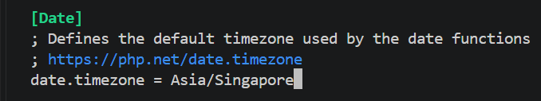
    Do the same for `/etc/php/8.5/cli/php.ini`
    ```
    nano /etc/php/8.5/cli/php.ini
    ```

13. Set system timezone. Replace `Asia/Sinagpore` with your timezone
    ```
    timedatectl set-timezone Asia/Singapore
    ```

<h2>Configure MariaDB</h2>

14. Edit the server configuration file
    ```
    nano /etc/mysql/mariadb.conf.d/50-server.cnf
    ```

15. Under the `[mariadb]` section, add the following
    ```
    innodb_file_per_table=1
    lower_case_table_names=0
    ```
    It should look like this:
    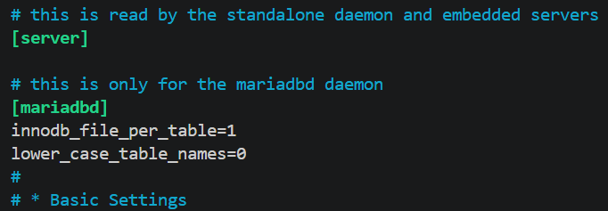

16. Restart MariaDB
    ```
    systemctl enable mariadb
    systemctl restart mariadb
    ```

17. Start the MariaDB client
    ```
    mysql -u root
    ```

18. Create a user in MariaDB 
    ```
    CREATE DATABASE librenms CHARACTER SET utf8mb4 COLLATE utf8mb4_unicode_ci;
    ```
    For the next command, change `librenms` and `password` with your own username and password (you can leave it as it is if you want)
    ```
    CREATE USER 'librenms'@'localhost' IDENTIFIED BY 'password';
    ```
    ```
    GRANT ALL PRIVILEGES ON librenms.* TO 'librenms'@'localhost';
    ```
    ```
    exit
    ```

<h2>Configure PHP FPM</h2>

19. Copy `/etc/php/8.5/fpm/pool.d/www.conf` to `/etc/php/8.5/fpm/pool.d/librenms.con`
    ```
    cp /etc/php/8.5/fpm/pool.d/www.conf /etc/php/8.5/fpm/pool.d/librenms.conf
    ```

20. Edit the file `/etc/php/8.5/fpm/pool.d/librenms.conf`
    ```
    nano /etc/php/8.5/fpm/pool.d/librenms.conf
    ```

21. Change `[www]` to `[librenms]`
    - Use `Ctrl` + `w` to search the keyword
    ```
    [librenms]
    ```
    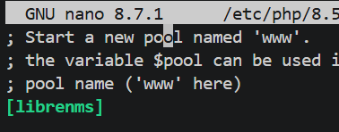

22. Change `user` and `group` to `librenms`
    - Use `Ctrl` + `w` to search the keyword
    ```
    user = librenms
    group = librenms
    ```
    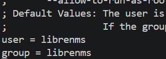

23. Change the path for `listen`
    - Use `Ctrl` + `w` to search the keyword
    ```
    listen = /run/php-fpm-librenms.sock
    ```
    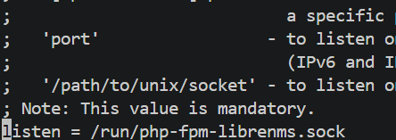

<h2>Configure Web Server</h2>

24. Open the configuration file
    ```
    nano /etc/nginx/conf.d/librenms.conf
    ```

25. Paste the following configuration into the file
    - <b>Note:</b> `server_name` was originally `librenms.example.com` but I swapped it with my Ubuntu VM IP address `10.0.11.2`. I used the IP address that was connected to the Oracle VirtualBox Internal Network
    ```
    server {
     listen      80;
     server_name 10.0.11.2;
     root        /opt/librenms/html;
     index       index.php;

     charset utf-8;
     gzip on;
     gzip_types text/css application/javascript text/javascript application/x-javascript image/svg+xml text/plain text/xsd text/xsl text/xml image/x-icon;
     location / {
      try_files $uri $uri/ /index.php?$query_string;
     }
     location ~ [^/]\.php(/|$) {
      fastcgi_pass unix:/run/php-fpm-librenms.sock;
      fastcgi_split_path_info ^(.+\.php)(/.+)$;
      include fastcgi.conf;
     }
     location ~ /\.(?!well-known).* {
      deny all;
     }
    }
    ```

26. Remove the following files
    ```
    rm /etc/nginx/sites-enabled/default /etc/nginx/sites-available/default
    ```

27. Restart `nginx` and `php`
    ```
    systemctl restart nginx
    systemctl restart php8.5-fpm
    ```

<h2>Allow Inms command completion</h2>

28. This feature lets you use the `tab` key to complete lnms commands. It works in the same way as for normal Linux
    ```
    ln -s /opt/librenms/lnms /usr/bin/lnms
    cp /opt/librenms/misc/lnms-completion.bash /etc/bash_completion.d/
    ```

<h2>Configure snmpd (v2c)</h2>

29. Copy the following file
    ```
    cp /opt/librenms/snmpd.conf.example /etc/snmp/snmpd.conf
    ```

30. Open the configuration file
    ```
    nano /etc/snmp/snmpd.conf
    ```

31. Replace the community string with your own
    ```
    public
    ```
    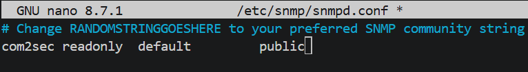

32. Install the snmp distro for LibreNMS
    ```
    curl -o /usr/bin/distro https://raw.githubusercontent.com/librenms/librenms-agent/master/snmp/distro
    ```

33. Set the permissions for the file
    ```
    chmod +x /usr/bin/distro
    ```

34. Enable and restart snmp service
    ```
    systemctl enable snmpd
    systemctl restart snmpd
    ```

<h2>Cron job</h2>

35. Copy the following file
    ```
    cp /opt/librenms/dist/librenms.cron /etc/cron.d/librenms
    ```

36. Set the permissions for the file
    ```
    chmod 644 /etc/cron.d/librenms
    ```

<h2>Enable the scheduler</h2>

27. Copy the following file
    ```
    cp /opt/librenms/dist/librenms-scheduler.service /opt/librenms/dist/librenms-scheduler.timer /etc/systemd/system/
    ```

28. Start the service
    ```
    systemctl enable librenms-scheduler.timer
    systemctl start librenms-scheduler.timer
    ```

<h2>Enable logrotate</h2>
This will allow the log file to be kept at a maximum size

29. Copy the following file
    ```
    cp /opt/librenms/misc/librenms.logrotate /etc/logrotate.d/librenms
    ```

30. Set the permissions for the file
    ```
    chmod 644 /etc/logrotate.d/librenms
    ```

We are now complete with the LibreNMS installation. There are a few more steps inside the official documentation, but those are not necessary. I stopped here and everything is still able to work.

<h2>LibreNMS GUI Setup</h2>

31. Open the GUI for your Ubuntu VM

32. Open `Firefox` and key in the IP address mentioned in Step 25 `10.0.11.2`. 
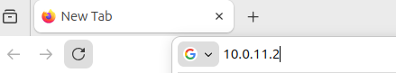
You should see the following page:<br>
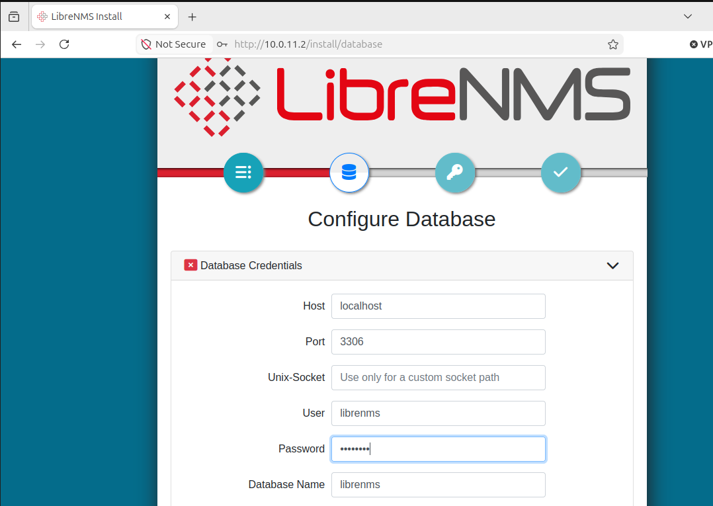

33. Enter your username and password from Step 18 and click on `Check credentials`

34. After the check is complete, click on `Build Database`
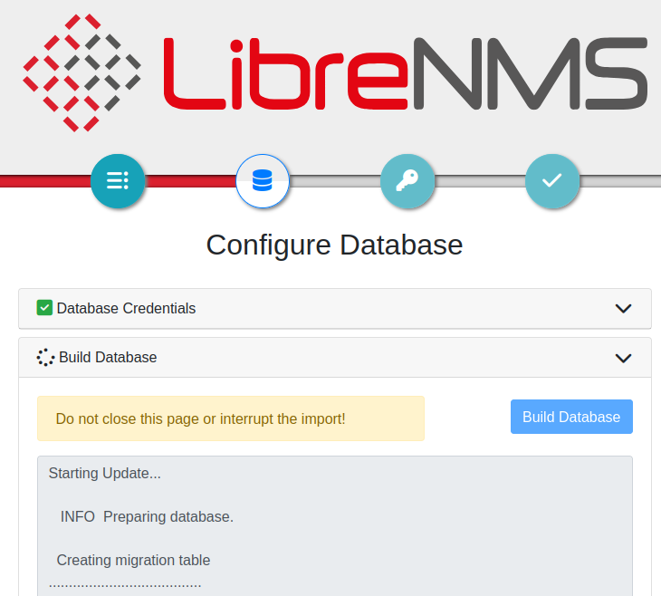

35. Setup the admin user. You can use any username and password
    - `User`: `admin`
    - `Password` :`<your_own_password>`
    - `Email`: not necessary (I left it blank)

36. Click on `Finish Install`
    - Don't need to edit anything on the page
    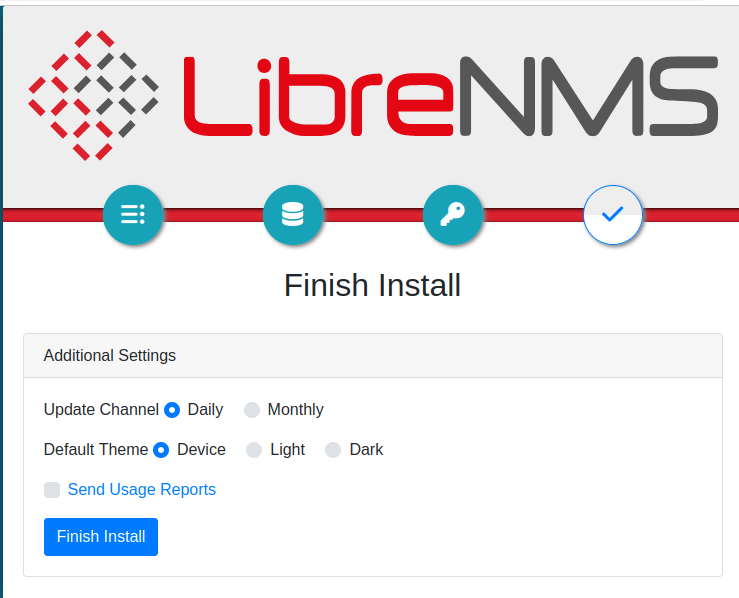

37. You will be shown a login page. Login with your admin account<br>
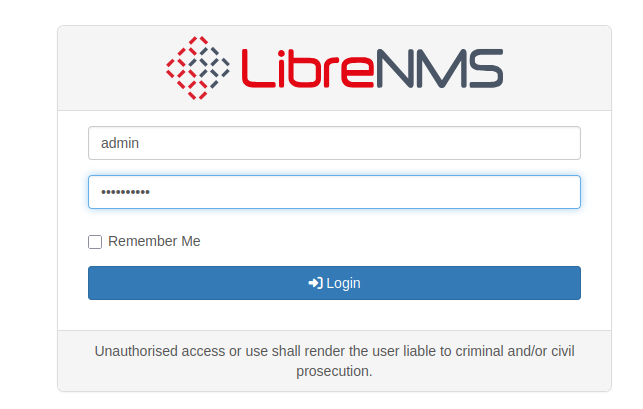<br>

    - The login should be successful and you will be shown this page:<br>
    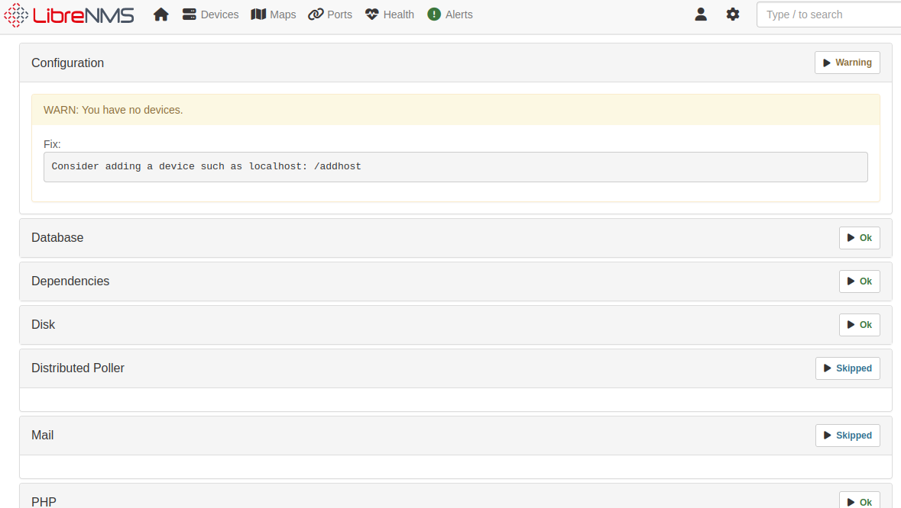
        - If you scroll down, there may be some error warnings, but they will not have any effect 


<h1>Connecting GNS3 devices to LibreNMS</h1>
The current network in GNS3 is as shown:<br>

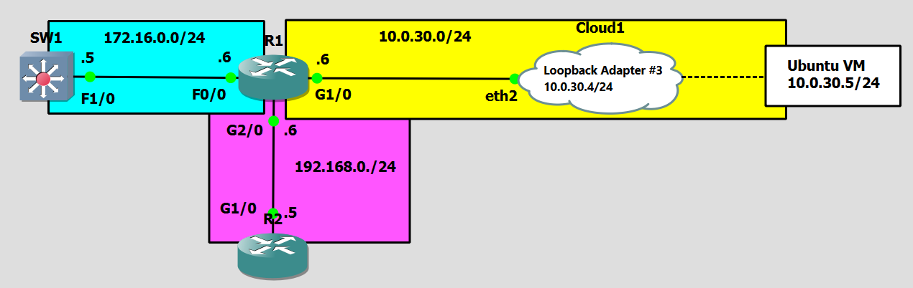<br>

LibreNMS collects information from the devices by sending SNMP GET messages to the devices and the devices will send a Response to LibreNMS.<br>
So we now, we will be setting up SNMP on `R1`. If everything works, do the same for `R2` and `SW1`

<h2>Configure SNMP on Cisco devices</h2>

38. From R1's CLI, set the community string to that mentioned in Step 31 - `public` 
    ```
    R1(config)#snmp-server community public RO
    ```

39. Check if working
    ```
    R1(config)#do show running-config | include snmp-server
    ```
    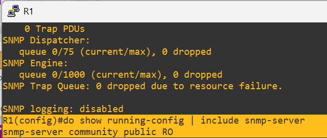
    
40. Test if SNMP is working by running the following commands from the Ubuntu VM:
    ```
    snmpget -v2c -c public 10.0.11.3 1.3.6.1.2.1.1.5.0
    snmpwalk -v2c -c public 10.0.11.3 1.3.6.1.2.1.1
    ```
    The output should be as follows:<br>
    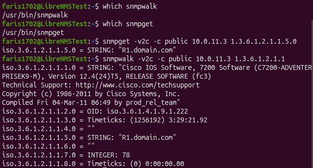

<h2>Add device to LibreNMS</h2>

41. From the logged in page on LibreNMS webpage, select `Devices` > `Add device`
    - `IP`: `10.0.11.3` (IP address of R1's port connected to Internal Network)
    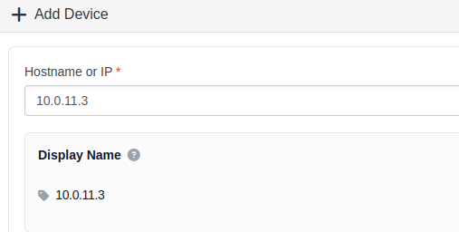
    - Under `Credentials`, select `Create New Secret`
    - Under `Community`, enter the community string used in Step 31 - `public` in this case
    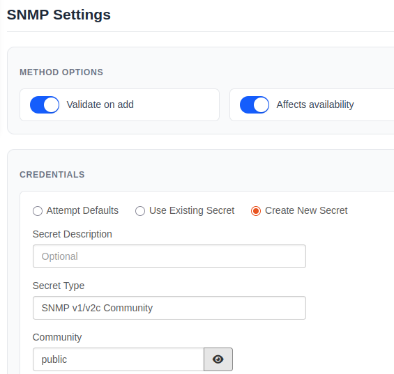
    - Leave the other settings as their default and add the device

42. It should be successful and you will see this page
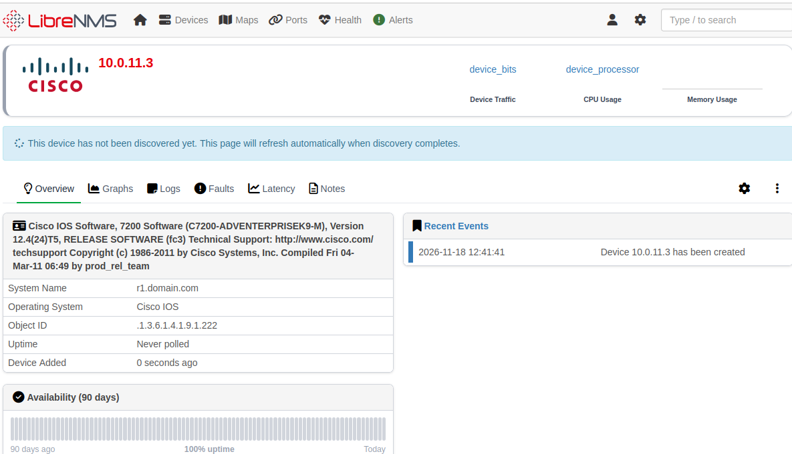
    
    - After a while, the IP address at the top left of the page will turn green

43. Repeat Step 38 to Step 42 for `R2` and `SW1`

<h1>Setting up LibreNMS API Key</h1>
Now we will setup an API key for LibreNMS so that we can run LibreNMS functions through Python code

44. Go to `Settings` (Gear icon) > `Global Settings` > `API`

45. Enable `API v1 (Beta)`

46. Go to `Settings` (Gear icon at top right) > `API` > `API Tokens` > `Create API Access Token`
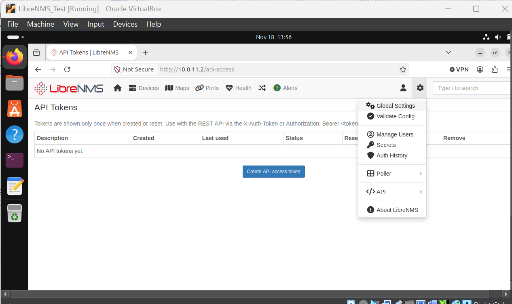

47. Just key in a short description and click `Create API Token` 
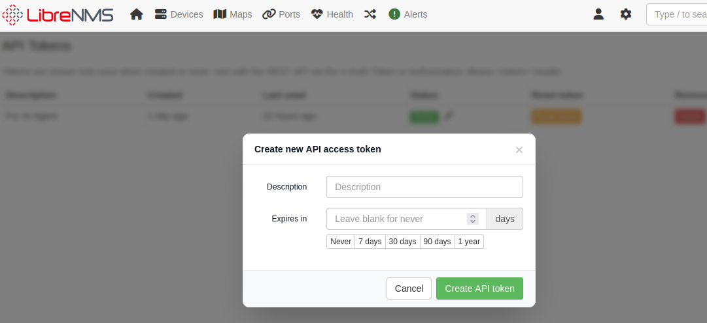

47. The token will be created. Save it as you will not be able to view the key again
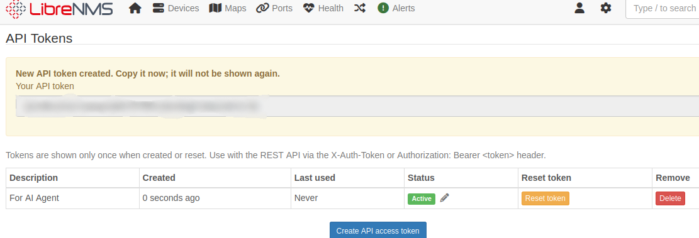

<h2>Testing LibreNMS API Key</h2>
We will now test whether the LibreNMS API key is working. We will create and run some Python scripts that utilise the API key and make sure that everything is working.<br>
<br>
For the following steps, SSH from your local machine (VSCode/putty/cmd) so that it will be easier to copy past code.

48. Open the Ubuntu VM terminal

49. Go to the AI Agent project directory (created in the previous setup)
    ```
    cd AI_Agent_Network_Automation
    ```

50. Activate the virtual environment
    ```
    source venv/bin/activate
    ```

51. Install `Requests`
    ```
    pip install requests
    ```

52. Run the following command to test if your API key is working:
    ```
    curl -H "X-Auth-Token: <YOUR_API_TOKEN>" http://127.0.0.1/api/v0/devices
    ```
    You should see the following output
    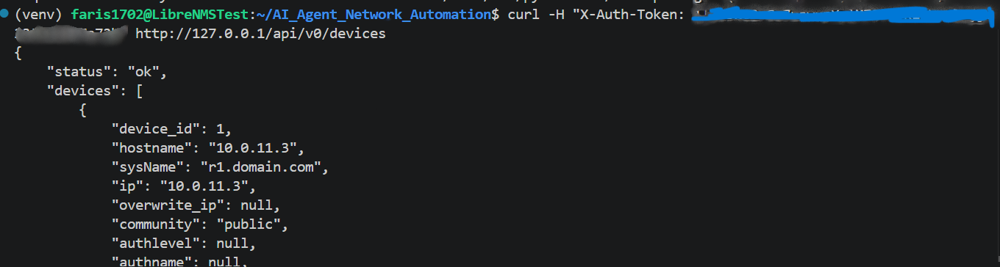

53. Now, add your API key and URL to your `.env` file
    ```
    OPENAI_API_KEY="<LLM_API_KEY>"
    LIBRENMS_API_KEY="<LIBRENMS_API_KEY>"
    LIBRENMS_URL="http://127.0.0.1"
    ```

54. Create `test_librenms.py` 
    ```
    nano test_librenms.py
    ```

55. Copy the script `test_librenms.py` from this repository and paste it into the newly created file and save

56. Run the script
    ```
    python3 test_librenms.py
    ```
    The output should be like this:
    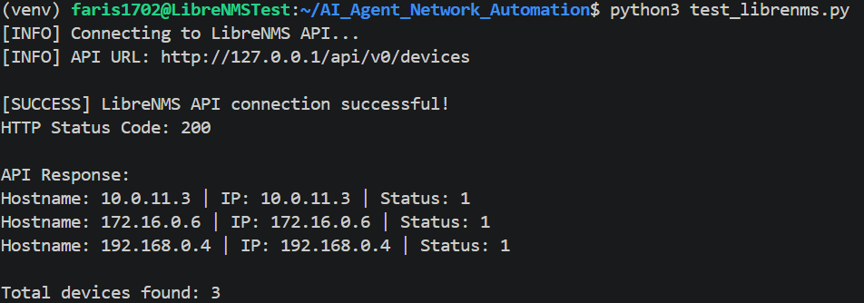

The LibreNMS API setup is completed.

<h1>AI Agent LibreNMS setup</h1>
We will now integrate the LibreNMS tools into the AI Agent.

57. In the `tools` directory, create `librenms_tools.py` and copy the content from this repository
    ```
    nano tools/librenms_tools.py
    ```

58. In the `tools` directory, create `test_librenms_tools.py` and copy the content from this repository. This script will make sure all the tools are working.
    ```
    nano tools/test_librenms_tools.py
    ```

59. Run `test_librenms_tools.py`
    ```
    python3 tools/test_librenms_tools.py
    ```
    - It should be successful

60. Create `system_prompt_2.py` and copy the contents from this repository. This file contains the system prompt that will be used by the AI agent.
    ```
    nano system_prompt_2.py
    ```

61. Create `ai_agent_7_librenms.py` and copy the contents from this repository. This file is the main AI agent script.
    ```
    nano ai_agent_7.py
    ```

62. Run the script
    ```
    python3 ai_agent_7_librenms.py
    ```
    You are now running the AI agent. You can ask the agent questions regarding the network.

<br>
This is the end of the setup. Thank you for reading.